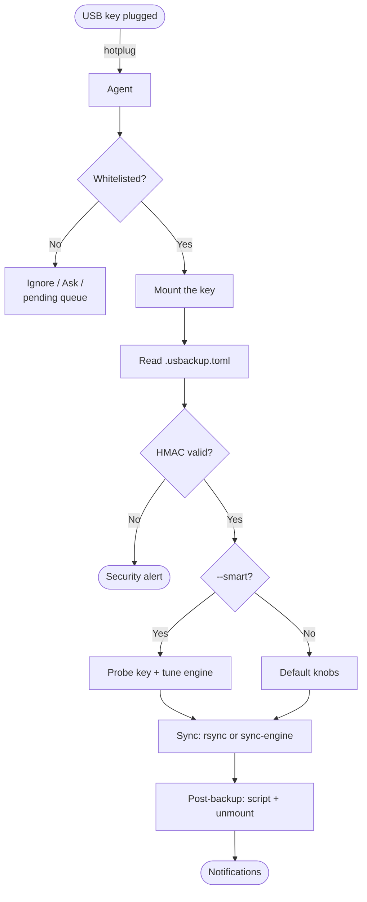

# USBackup

<p align="center"></p>

Automated USB backup agent written in Rust. Runs in the background, detects USB keys the instant they are plugged in, and runs signed `rsync` backups from your machine to the key.

```
$ usbackup
[+] Device detected: SanDisk Ultra (0951:1666)
    → uuid=ABCD-1234  whitelisted, starting backup
    → rsync -avP --delete ~/Documents/ /run/media/…/backups/docs
[✓] Backup finished for SanDisk Ultra
```

## Name

**USBackup** is a contraction of **USB** + **Backup**: the medium you plug in, and the job it does. The name is pronounced "USB-backup" (*you-es-bee-backup*), written as one word with camel case to keep both halves readable.

## Features

- **Hotplug detection** — native USB events via `nusb`, no polling.
- **Zero-trust config** — backup rules live *on the key* (`.usbackup.toml`) and are HMAC-SHA256 signed with a per-machine secret; a tampered or foreign config is rejected outright.
- **UUID + VID/PID identification** — each key is matched by filesystem UUID *and* the vendor/product IDs of the device that triggered the event, so a second plugged-in key is never misidentified.
- **Three device actions** — `Whitelist` (auto-backup), `AskEachTime` (confirm each plug-in), `IgnoreForever` (skip silently).
- **Incremental snapshots** — `rsync --link-dest` hard-link versioning with a `latest` symlink; minimal disk usage, full history. Disabled on Windows ([details](docs/windows.md#behaviour--quirks)).
- **Auto-mount / unmount** — `udisksctl` mount on detection on Linux (Windows and macOS mount volumes natively), optional unmount after a successful backup (resolved to the real block device node).
- **Smart exclusions** — per-rule excludes, bundled defaults, optional `.gitignore` templates fetched from GitHub, and local `.gitignore` detection.
- **Headless-safe** — without a TTY (systemd, launchd, scheduled task) unknown devices are queued as *pending* and a desktop notification tells you to run `usbackup approve <uuid>`.
- **Post-backup actions** — run a shell command and/or unmount, with exit-code checking and error notifications.
- **Platform-native paths** — config, logs and service files follow each OS convention (XDG, `%APPDATA%`, `~/Library`); see the [platform guides](#platform-guides).
- **Interactive wizard** — first plug-in launches a guided setup (name, source folders, exclusions, snapshot mode, unmount, post-script).
- **Background service** — one flag installs and enables the native user-level agent (systemd, Task Scheduler or launchd).
- **Verbose logging** — `-v` (debug) / `-vv` (trace) / `-q` (warn), or `RUST_LOG` for fine-grained control.
- **Native sync engine** — opt-in pure-Rust backend (`--features sync-engine`) that runs in-process with no external `rsync`; see [Native sync engine](#native-sync-engine-opt-in).

## Supported OS

| OS | Status | Notes |
| :-- | :-- | :-- |
| **Linux** | ✅ | Native `udev` + `udisksctl`. Releases ship amd64 and arm64 binaries. |
| **Windows** | ✅ | WMI discovery + native auto-mount, Task Scheduler service, `incremental` off ([details](docs/windows.md#behaviour--quirks)). Releases ship x64 and arm64 `.exe`. |
| **macOS** | ✅ | `diskutil` discovery + mount, launchd LaunchAgent service, universal binary (Apple Silicon + Intel). |

## Installation

### Quick install (Linux / macOS)

```bash
curl -fsSL https://raw.githubusercontent.com/YoannDev90/USBackup/master/install.sh | bash
```

Detects your OS/arch (Linux amd64/arm64, macOS universal), verifies the
SHA256 checksum, installs to `~/.local/bin`, and offers to set up the
background agent (systemd on Linux, launchd on macOS).

### Quick install (Windows)

```powershell
irm https://raw.githubusercontent.com/YoannDev90/USBackup/master/install.ps1 | iex
```

Same flow as `install.sh`: checksum verification, install to
`%LOCALAPPDATA%\Programs\USBackup`, optional scheduled task.

### Build from source

```bash
git clone https://github.com/YoannDev90/USBackup.git
cd USBackup
cargo build --release
# binary at target/release/USBackup
```

Or grab a prebuilt binary from the [Releases](https://github.com/YoannDev90/USBackup/releases) page (includes SHA256 checksums).

### Platform guides

Dependencies, service setup, platform behaviour and file locations:

- **[Linux](docs/linux.md)** — distro packages, systemd user service, udev + `udisksctl`, XDG paths.
- **[Windows](docs/windows.md)** — rsync MSVC port, Task Scheduler task, WMI discovery, quirks.
- **[macOS](docs/macos.md)** — launchd LaunchAgent, `diskutil` discovery, Gatekeeper, universal binary.

## Quick start

1. **Plug in a USB key.** The agent detects it and prompts:

   ```
   New device 'SanDisk Ultra' detected (ABCD-1234). Choose an action:
   > Approve and configure backups (Whitelist)
     Approve, but ask every time (AskEachTime)
     Ignore this device forever (IgnoreForever)
     Cancel
   ```

2. **Pick a friendly name, source folders, exclusions, snapshot mode, and post-backup options.** The wizard writes a signed `.usbackup.toml` to the root of the key and adds the UUID to your local whitelist.

3. **Every subsequent plug-in** runs the backup automatically. Notifications report start, success, and failure.

## How it works



1. **Detect** — `nusb` hotplug events, no polling.
2. **Identify** — resolve the USB partitions of the triggering device (`udev` on Linux, WMI on Windows, `diskutil` on macOS), match by VID/PID, read the filesystem UUID.
3. **Authorize** — check the UUID against the local whitelist / ask-each-time / ignore lists.
4. **Verify** — mount the key, read `.usbackup.toml`, check the HMAC-SHA256 signature against the machine-local secret. A mismatch (tampering, config from another machine) aborts the backup and raises a security alert.
5. **Execute** — for each backup rule, run `rsync` (optionally `--link-dest` snapshots, `--delete` mirror mode), then post-backup actions.

### Device actions

| Action | Behaviour |
| :-- | :-- |
| `Whitelist` | Backup runs automatically on every plug-in. |
| `AskEachTime` | A confirmation prompt appears on every plug-in (TTY only; skipped when headless with a notification). |
| `IgnoreForever` | Device is silently skipped. |

### Example `.usbackup.toml` (on the key)

```toml
name = "My SanDisk Key"
vendor_id = 2457
product_id = 5769
uuid = "ABCD-1234"
signature = "a1b2c3d4..."   # HMAC-SHA256, managed by the wizard
action = "Whitelist"

[[backup_rules]]
source_path = "/home/user/Documents"
destination_path = "backups/docs"
exclude = ["*.tmp", "cache/"]
delete_missing = true        # mirror mode: remove files deleted from source
incremental = true           # time-stamped snapshots via hard links
unmount_after = true         # auto-unmount when done
post_backup_script = "notify-send 'Backup done!'"
```

> **Do not hand-edit this file.** The HMAC signature covers every field; any change invalidates it and the backup will be rejected. Re-run the wizard to reconfigure.

### File locations

Config, logs and service definitions live where each platform expects
them — see the *File locations* table in the [platform guides](#platform-guides)
([linux](docs/linux.md#file-locations) · [windows](docs/windows.md#file-locations) · [macos](docs/macos.md#file-locations)).

## Native sync engine (opt-in)

Beyond the default `rsync` backend, USBackup ships a pure-Rust sync engine
that runs entirely in-process — no child process, no shell, no C toolchain.
It is portable by construction (Linux, macOS, Windows) and is the intended
replacement for the `rsync` dependency.

```bash
cargo build --release --features sync-engine
```

`rsync` stays the default backend until the engine is validated end-to-end on
every supported platform; the feature flag keeps that switch explicit.

### Capabilities

- **Scan + compare** — metadata-only change detection (mtime + size, 2 s
  tolerance for FAT/exFAT); per-rule excludes, bundled defaults and
  `.gitignore` are honored, including on incremental snapshots.
- **Copy** — atomic temp-file + rename, preserving mtime and permissions;
  bounded parallelism with separate metadata and bulk-I/O pools.
- **Snapshots** — incremental hard-link snapshots with retention, or a plain
  mirror. Symlinks are preserved as-is and never dereferenced.
- **Delta** — optional Rabin-Karp rolling-hash delta for large files
  (off by default).
- **Portable** — no `unsafe`, no C dependencies; cross-compiles to Linux,
  macOS and Windows.

### Benchmarks

Criterion harness in `benches/sync_engine.rs` (run with `cargo bench`),
measured on local NVMe under Linux:

| Benchmark | Result |
| :-- | :-- |
| Scan 10 000 files | ~20 ms (≈490 k files/s) |
| Scan 100 000 files | ~222 ms (≈450 k files/s) |
| Cold backup, 10 000 files | ~63 ms |
| Cold backup, 100 000 files | ~640 ms (≈156 k files/s) |
| No-op verify, 100 000 files | ~512 ms |
| Incremental snapshot, 10 000 hard links | ~64 ms |

The default pool sizes (metadata concurrency 8, bulk concurrency 2, 1 MiB
bulk threshold) were selected from sweeps in that harness. USB-key thresholds
stay gated on real-hardware measurements — local disk and a flash key behave
differently.

## CLI

```
usbackup [FLAGS] [COMMAND]

Commands (default = daemon):
  (none)                    Start the background agent
  approve <uuid> [--configure]
                            Approve a pending device; --configure also
                            runs the interactive backup wizard
  list-devices              List approved / ask-each-time / ignored /
                            pending devices
  --install-service         Install and enable the background service
  --help, -h                Show help
  --version, -V             Show version

Log verbosity flags (combinable with any command):
  (none)                    info   — normal runtime events
  -v,  --verbose            debug  — USB scan details, rsync command
                                   lines, mount search, config decisions
  -vv                       trace  — everything, incl. per-line hotplug
  -q,  --quiet              warn   — warnings and errors only
  RUST_LOG=<filter>         overrides the flags above
```

### Examples

```bash
usbackup                              # start the agent (foreground)
usbackup -v                           # agent with debug logging
usbackup list-devices                 # show all known devices
usbackup approve ABCD-1234            # approve a device queued by a headless run
usbackup approve ABCD-1234 --configure  # approve + launch the wizard now
usbackup --install-service            # set up the background service
```

When the agent runs **without a TTY** (as a background service), unknown devices are recorded as *pending* and a desktop notification tells you to run `usbackup approve <uuid>` from a terminal.

## Development

```bash
cargo build          # debug build
cargo test           # run unit tests
cargo clippy         # lints
cargo run -- -v      # run from source with debug logging
```

Unit tests cover the HMAC sign/verify round-trip, tamper detection, canonical serialization, and path sanitization — no hardware required.

## Roadmap

- [x] Decentralized TOML configuration stored on the key.
- [x] HMAC-SHA256 signature verification.
- [x] Automatic partition mounting via `udisksctl`.
- [x] Platform-native config and log paths (XDG, `%APPDATA%`, `~/Library`).
- [x] Incremental snapshots (`--link-dest`).
- [x] Post-backup actions (script + unmount, supervised).
- [x] Desktop notifications.
- [x] Device actions: Whitelist / AskEachTime / IgnoreForever.
- [x] Headless approval via CLI (`approve`, `list-devices`).
- [x] Verbose logging (`-v` / `-vv` / `-q` / `RUST_LOG`).
- [x] Unit tests for crypto and path sanitization.
- [x] Native sync engine (opt-in, `--features sync-engine`).
- [ ] Multi-target backup (SSH / cloud).
- [ ] Log rotation beyond single-file `.1` backup.
- [ ] Backup scheduling / interval triggers.
- [ ] Sync engine as the default backend (replace `rsync`).

## License

[MIT](LICENSE)
